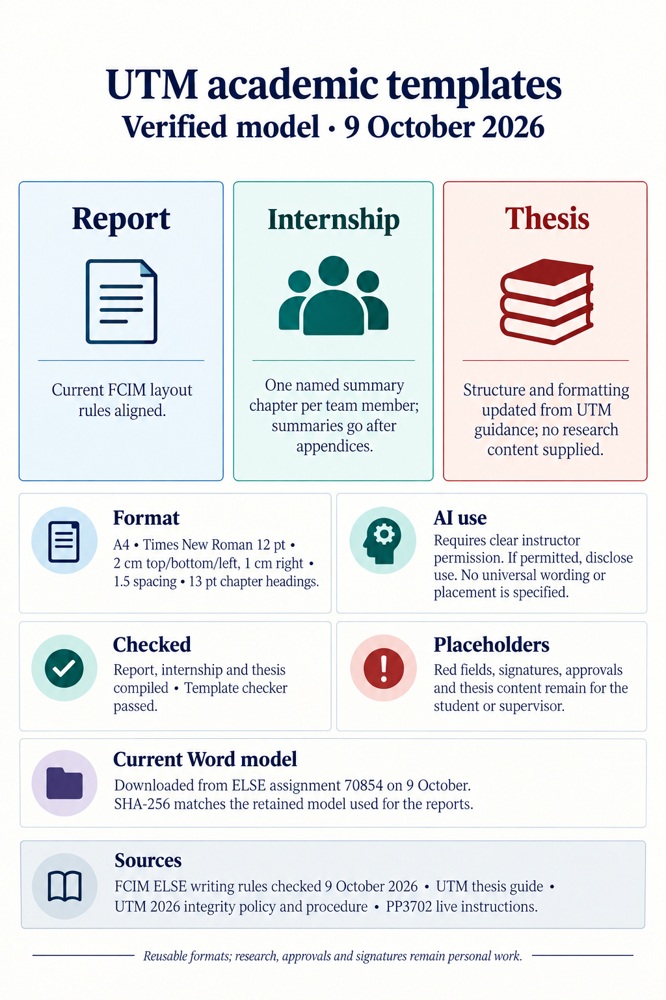

# UTM Academic LaTeX Templates

LaTeX templates for students at the Technical University of Moldova (UTM): laboratory and course reports, the team internship report, the license thesis, and conference articles and abstracts.

The report templates follow the current PP3702 Word model and FCIM formatting rules for covers, contents, headings, captions, references and appendices. The Word attachment downloaded from ELSE assignment 70854 on 9 October and again on 10 October 2026 has the same SHA-256 as the retained 2 October reference, so the measured Word baseline is byte-identical. See `docs/rules/` for source details.



## Start in three steps

1. **Pick a template** from `templates/`:

   | You are writing | Template | Files you edit |
   |---|---|---|
   | Laboratory work, course, PBL or semester report (one author) | `templates/report/` | `main.tex` |
   | Team internship report (mandatory ELSE model) | `templates/internship/` | `main.tex` (cover) and `chapters/*.tex` |
   | License thesis / graduation project | `templates/thesis/` | `main.tex` |
   | Conference article | `templates/article/` | `main.tex` |
   | Conference abstract | `templates/abstract/` | `main.tex` |

2. **Copy the folder** to wherever the work belongs, either by hand or with:

   ```powershell
   python tools\new.py report D:\edu\faf\sem3\oop\lab-1
   ```

   Every template folder is self-contained (class file, logo, example figure), so a copied folder compiles on its own. It doesn't need this repository.

3. **Write and compile** inside the copied folder:

   ```powershell
   tectonic main.tex
   ```

   `main.pdf` appears next to `main.tex`. Install [Tectonic](https://tectonic-typesetting.github.io/) once; it downloads missing LaTeX packages by itself.

## How a template is organised

```text
templates/internship/
  main.tex              cover fields and the order of the parts
  chapters/             one file per part, numbered in the order they appear in the PDF
    01-abstract.tex
    02-abbreviations.tex    (optional; enable it in main.tex)
    03-introduction.tex
    04-chapter-1-domain-analysis.tex
    ...
    08-references.tex
    09-appendix-a.tex
    11-internship-summary.tex   (body repeated once per team member)
  figures/              your images; include them by name: \includegraphics{diagram}
  utmreport.cls         layout rules (margins, fonts, headings); do not edit
  utm-logo.jpeg         cover logo
```

`templates/report/` has the same pieces, but the whole text is in `main.tex`, because a lab report is short.

**Red text is a placeholder.** Example text is wrapped in `\placeholder{...}` and printed in red, as in the Word model. Replace it all, then check your folder:

For the current PP3702 internship report, add one `\internshipsummary{Full Name}` call for every team member after all appendices. Each call creates a separate final chapter and a title-case table-of-contents entry named `Internship Summary Report_Full Name`. Keep the call count and names aligned with the cover team list.

```powershell
python tools\check.py D:\edu\faf\sem3\oop\lab-1
```

The check reports leftover placeholders, the keyword count, citations that have no reference (and references that are never cited), missing images, and enumeration punctuation.

## What the report class does for you

Following the ELSE Word template:

- A4, margins top/bottom/left 2 cm and right 1 cm; Times New Roman 12 pt, justified, 1.5 spacing, 1.25 cm first-line indent;
- cover with logo, faculty, department and programme; document type 20 pt and title 18 pt, both bold uppercase;
- internship cover with team, member table, mentor, `*Signature` cells, signing attestation, submission date;
- **TABLE OF CONTENTS** with uppercase chapters and indented subchapters and appendices;
- cover, contents and abstract are counted but not numbered; page numbers appear from the Introduction;
- chapters `1 TITLE` on a new page, centered, bold uppercase 13 pt; subchapters `1.1 Title` bold 12 pt, indented 1.25 cm;
- unnumbered INTRODUCTION, CONCLUSIONS and REFERENCES, all listed in the contents;
- `Figure 1.1 – Title` bold and centered below; `Table 1.1 – Title` bold and right-aligned above; table text 11 pt single-spaced;
- code in Courier New 10 pt, single-spaced;
- references numbered `1.`, `2.`, ...;
- APPENDICES, then `APPENDIX A – Title`, each on a new page.

Commands you use in the text:

| Command | Purpose |
|---|---|
| `\makeutmreporttitlepage`, `\makeutminternshiptitlepage` | cover |
| `\internshipsummary{Full Name}` | append one named internship-summary chapter for a team member |
| `\begin{utmabstract}[Abstract] ... \utmkeywords{...} \end{utmabstract}` | abstract with 5–7 lowercase keywords |
| `\begin{utmabbreviations} \item[API] ... \end{utmabbreviations}` | list of abbreviations (before the Introduction) |
| `\utmintroduction`, `\utmconclusions` | unnumbered Introduction / Conclusions |
| `\chapter{...}`, `\section{...}`, `\subsection{...}` | numbered chapters, at most three levels |
| `\begin{utmenumerate}` | a), b), c) enumeration; items end with `;` |
| `\begin{thebibliography}{9} \bibitem{key} ...` and `\cite{key}` | references |
| `\appendix` then `\chapter{Title}` | appendices |
| `\unnumberedchapter{Title}` | any other unnumbered chapter listed in the contents |
| `\placeholder{...}` | red text to replace |

Use `\selectlanguage{romanian}` instead of `english` for a Romanian report; headings switch to Introducere, Concluzii, Cuprins, Bibliografie, Anexa and Figura/Tabelul.

## Writing rules

The Word template also sets content rules that the class cannot enforce:

- impersonal style: no first-person pronouns;
- every chapter opens with at least one paragraph before its first subchapter;
- a subchapter is at least one full page; two subchapters do not start on the same page;
- introduce every table and figure in a short paragraph before it; never start a page with one;
- the introduction is typically 1–2 pages; the theoretical part does not exceed 40%;
- abbreviations and terms outside the language of instruction go in the list of abbreviations;
- code longer than half a page goes in an appendix referenced from the text;
- every source is cited in the text and listed in References.
- use generative AI on coursework only when the instructor clearly permits it; when permitted, disclose its use in the form the course specifies and preserve the student's own intellectual contribution.

Full rules: [ELSE report rules](docs/rules/ELSE-report-template.md), [UTM rules (EN)](docs/rules/UTM-writing-rules-and-formats-EN.md), [UTM rules (RO)](docs/rules/UTM-writing-rules-and-formats-RO.md). Stricter instructions from a teacher, department or supervisor take precedence.

## Thesis, article and abstract

- `templates/thesis/` uses `\documentclass[thesis]{utmreport}`: cover and title page, task-sheet placeholder, handwritten-declaration placeholder, supervisor-opinion placeholder, Romanian and English abstract placeholders, contents, chapters, bibliography and annexes. For a thesis written in another language, provide title pages in that language and Romanian. The official UTM guide recommends 50–80 pages excluding annexes and lets the department set the exact limit; the theoretical part should stay at or below 40%, and figures/graphs at or below 30% of the volume.
- UTM requires clear instructor permission before generative AI is used for coursework. If the course allows it, the student must disclose use explicitly and keep their own intellectual contribution. The university documents do not supply a universal disclosure sentence.
- `templates/article/` follows the UTM conference paper: uppercase 14 pt title, authors, affiliations, 150–200 word abstract without citations, 4–6 keywords, Introduction / Materials and Methods / Results and Discussion / Conclusions / References. The logo is off by default.
- `templates/abstract/` is the short conference abstract: title, authors, affiliations, corresponding author, supervisor, abstract and keywords.

## Repository layout

```text
templates/   the five templates; copy one to start
tools/       new.py (copy a template), check.py (validate), build.py (compile previews)
docs/        rules extracted from the UTM sources, and PDF previews of every template
shared/      maintainers only: the canonical utmreport.cls and logos
skills/      optional agent skill for writing UTM documents
legacy/      previous-year templates kept for comparison
```

## Maintaining the templates

`shared/utmreport.cls` is the canonical class; each template folder holds a copy. After changing anything in `shared/`:

```powershell
python tools\check.py --sync     # copy shared files into the templates, then validate
python tools\build.py            # recompile every template into docs/previews/
```

`python tools\check.py` without `--sync` fails when a template copy has drifted from `shared/`.

## Limits

The templates give a correct layout and catch common mistakes. Acceptance still depends on the content, originality, supervisor approval, signatures, deadlines and any stricter department rules.
